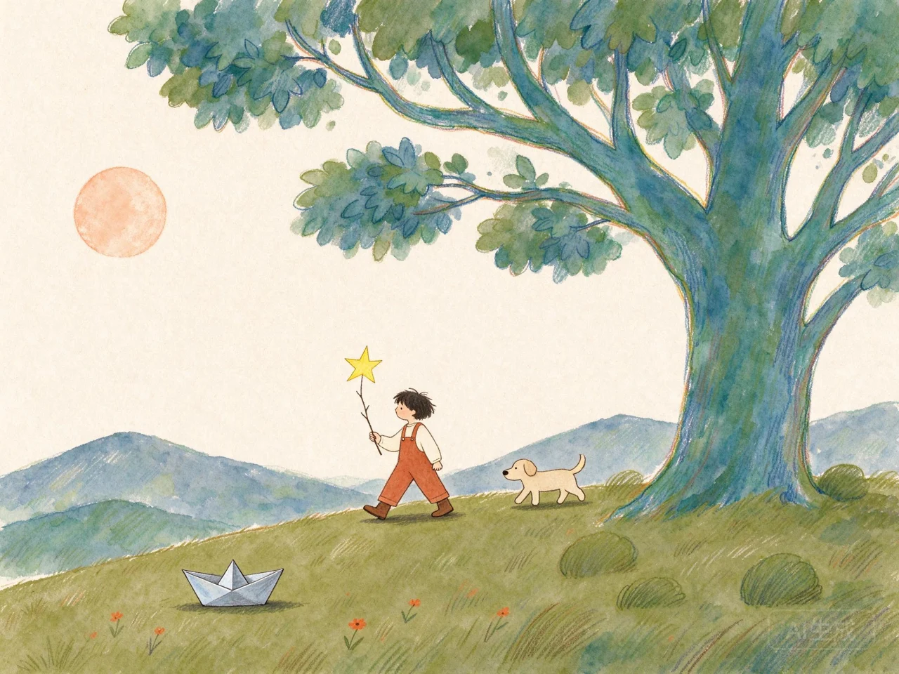

# 小小人物报 · Kidspaper

一次亲子对话，一份童年珍藏。

在家长陪伴下，从八个开放问题开始，记录孩子的原话、家长的关爱与托举，生成编辑式童年特别刊和三种可探索的梦想图景。多年后导入加密档案，还能由 AI 帮忙回看当时的表达。

**体验：<https://mikeywa.site/kidspaper/>**



## 纸上星球

[进入纸上星球](https://mikeywa.site/kidspaper/#planet)。地球以放大的纸上地平线呈现，按真实时间推进自转与昼夜，只点亮设备时区附近的虚构童年小报。32 份示例覆盖 22 个编辑区域，每日选出 26 份（每个区域至少一份），再按时差不超过 2 小时筛选。地球铺满页面底部与两侧，小报入口仅在地图光束上；悬停可查看昵称、示例地区、年龄与标题。光束逐一生长、向外渐隐；没有手动旋转。小报支持入场与退出动效、Esc 关闭、左右键与上一束/下一束切换，地球同步高亮。原有喜欢、邮票收藏、模拟信箱、七种阅读语言与 AI 共创仍保留。

当前为**本机模拟社区**，人物和回应均虚构，互动不跨用户同步；私人档案不会自动公开。中英界面，中文/英文编辑预译，其他五种语言按需调用 AI。详见 [社区玩法与边界](docs/COMMUNITY.md)。

## 运行

需要 Node.js 18.19+（推荐维护中的 LTS 版本），npm。

```sh
npm ci
cp .env.example .env
# 在 .env 配置自己的方舟 API key，不要把 key 放进前端或提交到 Git
npm run server
# 另开终端
npm run dev
```

打开 <http://127.0.0.1:5173/kidspaper/>。生产运行：

```sh
npm run build
npm start
```

生产服务器运行打包后的 `dist-server/server.cjs`，无需在服务器安装 npm 依赖。开发运行端口默认 4317，只监听 127.0.0.1；反向代理路径必须保持 `/kidspaper/` 前缀。设置 `NODE_ENV=production`、32 字符以上 `SESSION_SECRET`、`ALLOWED_ORIGINS` 和持久化 `DATA_DIR`。生产 cookie 使用 HTTPS。

## AI 接入

全部生成/理解能力使用同一个服务端 `ARK_API_KEY`：

| 功能 | 默认模型 | API |
| --- | --- | --- |
| 对话、可选追问、报告、档案导览 | `doubao-seed-2-1-lite-260915` | `/chat/completions` |
| WAV 语音转写 | `doubao-seed-2-1-lite-260915` | `/chat/completions` 的 `input_audio` |
| 梦想概念插画 | `doubao-seedream-5-0-flash-260915` | `/images/generations` |

可通过 `.env` 改模型；账号须具备对应模型的调用权限。[方舟文本 API 文档](https://docs.volcengine.com/docs/ark/chat-api?lang=zh)、[音频理解](https://docs.volcengine.com/docs/ark/audio-understanding?lang=zh)、[图片生成](https://docs.volcengine.com/docs/ark/image-generation-api?lang=zh)。

语音功能为“录音 → AI 转文字 → 家长核对 → 记录/对话”，不包含实时语音通话、AI 语音播报或声音复刻，不调用浏览器语音识别。Web Audio 录音上限 60 秒，转换为 16kHz 单声道 PCM WAV。麦克风须浏览器授权、HTTPS（或 localhost）。

公开演示站设置同源检查、家长确认会话、按 IP 限流、并发限制和每日全局额度。默认每日全站 500 次文字/音频、30 张图片，每 IP 100 次文字/音频、4 张图片，失败尝试亦计入。计数按上海日期持久化，重启不重置当日额度。公网匿名额度保护不等同于用户鉴权；大规模开放前应增加账号或邀请访问。

## 收藏与数据

- 亲子原话、报告、图片只保存在设备 IndexedDB；服务器不存储这些内容。
- 主动调用 AI 时，对应资料经服务器发给火山方舟；第三方按其政策处理数据。
- 加密导出 `.kidspaper`：PBKDF2-SHA256 + AES-256-GCM，密码只在本机使用。服务器无法找回密码。
- 清理浏览器会丢失本机记录，先导出备份。没有账号云同步或公开分享链接。
- 导入时验证档案结构、文件大小和图片格式。已生成内容可离线阅读（需页面已加载），后续 AI 对话仍依赖模型服务。

## 产品边界

这是一种亲子共创与记录方式。题库和报告未经过标准化或信效度检验，**不是心理测评、诊断、天赋鉴定或人生预测**。不把成人 Human 3.0、Dan Koe 或 MBTI 分类套给孩子。所有图景是想象，观察必须回到孩子的回答。档案 AI 不能代表孩子当年的真实意识、记忆或声音。

详细设计依据、数据处理和未实现能力见 [产品约定](docs/PRODUCT.md)；参考页面的配色、尺寸与交互实测见 [参考页分析](docs/REFERENCE_ANALYSIS.md)。样刊“小禾”及全部样刊原话为虚构。

## 验证与发布

```sh
npm test
npm run build
```

自动测试覆盖家长确认、跨域拒绝、报告引用来源、输入校验及敏感文件不可访问；使用隔离的本机模拟上游，不消耗实际模型额度。真实接口验收另见 [验收记录](docs/ACCEPTANCE.md)。

部署脚本 [`deploy/release.sh`](deploy/release.sh) 为本项目目标服务器设置独立 systemd 服务与 Nginx 子路径，保留旧版本及配置备份，检查失败会恢复。重复发布保留服务端密钥配置。不要在未经核对的其他服务器运行。

## 许可

源码与本项目原创素材采用 **PolyForm Noncommercial 1.0.0**，见 [LICENSE](LICENSE)。允许符合许可证条款的非商用使用、研究、学习与修改；商业使用须另获授权。

为满足非商用要求，本项目属于**公开源码 / source-available**；该许可证不是 OSI 定义的开源许可证。第三方依赖仍遵循各自许可证。AI 插画由方舟生成，并保留生成标识；不包含真实儿童肖像。

Required Notice: Copyright 2026 yanghaoleng. 小小人物报 / Kidspaper.
